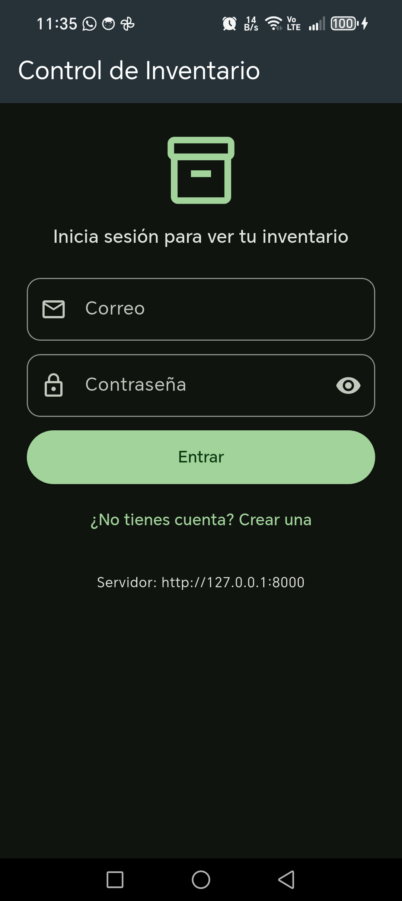
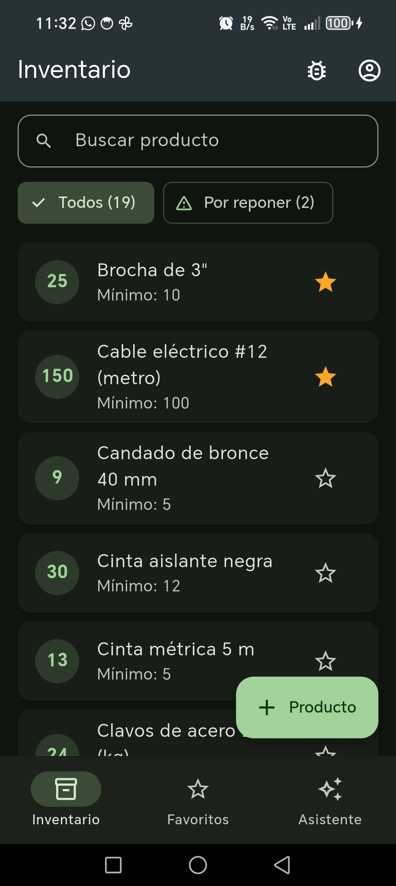
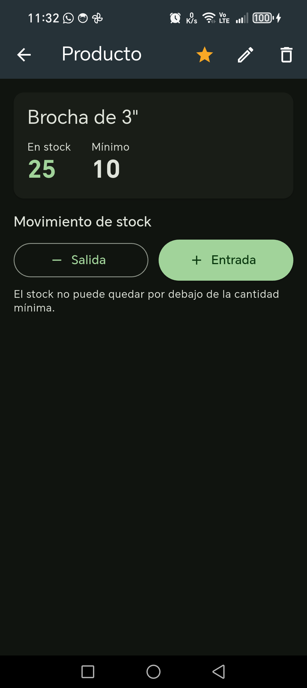
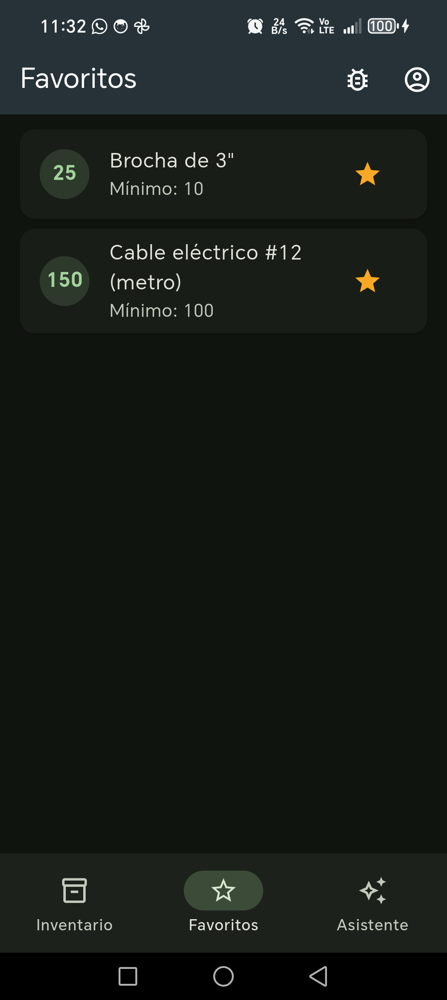
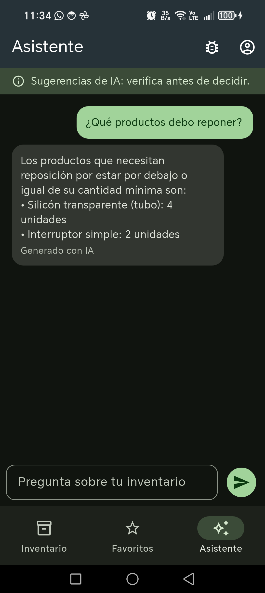
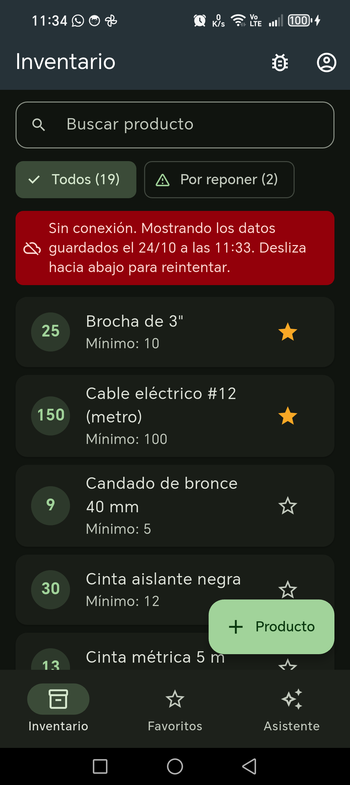

# Control de Inventario

App Flutter (Android) para llevar el stock de un pequeño negocio, como una ferretería: registrar productos, anotar entradas y salidas, ver de un vistazo qué está por debajo del mínimo y preguntarle a un asistente de IA qué conviene reponer.

Proyecto Final del curso *Desarrolla Aplicaciones Móviles Robustas con Flutter e IA*.

## Capturas de pantalla

| Inicio de sesión | Inventario | Detalle y stock |
|---|---|---|
|  |  |  |

| Favoritos | Asistente de IA | Sin conexión |
|---|---|---|
|  |  |  |

## Qué incluye

- [x] **Registro, inicio y cierre de sesión** con JWT contra un backend propio (FastAPI). El token se guarda en almacenamiento seguro (Keystore de Android) y la sesión se restaura al abrir la app.
- [x] **Lista principal con datos reales**: los productos vienen del backend (20 productos de demostración cargados con un script, no escritos en la app). Tiene búsqueda, filtro «Por reponer», pull-to-refresh y estados de carga, vacío y error distintos.
- [x] **CRUD remoto protegido por JWT**: crear, editar, registrar entradas y salidas de stock y eliminar (con confirmación). Cada usuario solo ve y modifica sus productos; el backend responde 403 si se intenta tocar uno ajeno.
- [x] **Persistencia local que sobrevive al cierre completo de la app** (Hive):
  - productos **favoritos** por usuario (estrella y pestaña propia);
  - **caché offline** del inventario por usuario: sin conexión se muestra la última copia con la fecha («Sin conexión. Mostrando los datos guardados el…»). Se borra al cerrar sesión.
- [x] **Asistente de IA con servidor propio** ([`asistente-server/`](asistente-server/)): la app no tiene ninguna clave; el servidor pide el inventario al backend con el token del usuario y consulta a Gemini (o responde con reglas si no hay clave).
- [x] **Estado compartido con GetX**: `AuthController`, `ProductosController`, `FavoritosController` y `AsistenteController`.
- [x] **Manejo de errores**: mensajes distintos para 400, 401, 403, 404, 422, 5xx, tiempo agotado y sin conexión; captura global de errores (sin pantalla roja) y registro con tokens ocultos.
- [x] **Menú de pruebas de errores** (🐞 en la barra superior) para forzar errores sin tocar código.
- [x] Extensión opcional: **modo oscuro** (sigue el tema del teléfono).

## Cómo ejecutarla

### Requisitos

| Componente | Versión usada |
|---|---|
| Flutter (canal stable) | 3.47.5 (Dart 3.13) |
| Android SDK y un emulador Android (o un teléfono) | API 24 o superior |
| Python + [uv](https://docs.astral.sh/uv/) (backend) | Python 3.12 |
| Node.js (servidor del asistente) | 18 o superior |
| Git | cualquiera reciente |

En Windows, el backend se probó dentro de WSL (Ubuntu); también funciona en Linux o macOS.

La app usa **tres componentes** y cada uno va en su propia terminal: backend (puerto 8000), servidor del asistente (puerto 3000) y app.

### 1. Backend de inventario (terminal 1)

Repositorio aparte: <https://github.com/wsuarezu/proyecto-integrador-speckit>

```bash
git clone https://github.com/wsuarezu/proyecto-integrador-speckit.git
cd proyecto-integrador-speckit
cp .env.example .env
```

Edita `.env` y pon en `SECRET_KEY` un valor aleatorio, por ejemplo el que imprime:

```bash
openssl rand -hex 32
```

Luego:

```bash
uv sync
uv run alembic upgrade head
uv run python -m app.seed
uv run uvicorn app.main:app --host 0.0.0.0 --port 8000
```

`app.seed` crea el **usuario de demostración** y sus 20 productos (puedes ejecutarlo varias veces; no duplica nada):

| Correo | Contraseña |
|---|---|
| `demo@inventario.com` | `demo1234` |

Son credenciales públicas a propósito, solo para evaluar en local. También puedes crear tu propia cuenta desde la app (empieza con el inventario vacío).

Comprobación: <http://localhost:8000/docs> muestra la documentación de la API.

### 2. Servidor del asistente (terminal 2)

Desde la carpeta de este repositorio. Detalles en [`asistente-server/README.md`](asistente-server/README.md).

Windows (PowerShell):

```powershell
cd asistente-server
$env:GEMINI_API_KEY="tu-clave-de-google-ai-studio"
node asistente-server.js
```

Linux, macOS o Git Bash:

```bash
cd asistente-server
export GEMINI_API_KEY="tu-clave-de-google-ai-studio"
node asistente-server.js
```

- La clave gratuita se crea en <https://aistudio.google.com/apikey>. **Es opcional:** sin `GEMINI_API_KEY` el servidor arranca en **modo REGLAS** y el asistente sigue funcionando con respuestas automáticas.
- El primer mensaje indica el modo (`modo GEMINI` o `modo REGLAS`).
- Prueba de la cadena completa, sin la app (con los dos servidores encendidos):

  ```bash
  node asistente-server/probar-e2e.js demo@inventario.com demo1234
  ```

### 3. App (terminal 3)

```bash
flutter pub get
flutter run
```

### Direcciones por entorno

La app recibe las direcciones con `--dart-define` (no tienen valores secretos; ver [`.env.example`](.env.example)):

| Entorno | Cómo ejecutar |
|---|---|
| **Emulador Android** | `flutter run` (por defecto usa `http://10.0.2.2:8000` y `http://10.0.2.2:3000`, que es el `localhost` del computador visto desde el emulador) |
| **Teléfono por USB** (recomendado) | `adb reverse tcp:8000 tcp:8000`, `adb reverse tcp:3000 tcp:3000` y luego `flutter run --dart-define=API_BASE_URL=http://127.0.0.1:8000 --dart-define=LLM_BACKEND_URL=http://127.0.0.1:3000` |
| **Teléfono por Wi-Fi** | Misma red que el computador: `flutter run --dart-define=API_BASE_URL=http://<IP-del-PC>:8000 --dart-define=LLM_BACKEND_URL=http://<IP-del-PC>:3000` (abre los puertos 8000 y 3000 en el firewall) |

La pantalla de inicio de sesión muestra abajo la dirección del backend que está usando, para diagnosticar rápido.

## APK

Descárgalo desde la sección [**Releases**](https://github.com/wsuarezu/controlinventario/releases) de este repositorio. Lo genera GitHub Actions al subir una etiqueta `v*` ([`.github/workflows/release-apk.yml`](.github/workflows/release-apk.yml)), después de volver a ejecutar el análisis y todas las pruebas.

El APK apunta a las direcciones del **emulador Android** (`10.0.2.2`). Para probarlo:

1. Enciende el backend y el servidor del asistente (pasos 1 y 2).
2. Instala el APK en el emulador, arrastrándolo a la ventana del emulador o con:

   ```bash
   adb install control-inventario-v1.0.0.apk
   ```

   Si antes instalaste la versión de depuración con `flutter run`, desinstálala primero (están firmadas con llaves distintas):

   ```bash
   adb uninstall com.example.controlinventario
   ```

3. Abre **Inventario** y entra con el usuario de demostración.

## Cómo comprobar el manejo de errores

| Qué probar | Cómo | Qué se ve |
|---|---|---|
| 401 (sesión caducada) | 🐞 → *Invalidar token* | Vuelve al login con «Tu sesión caducó. Inicia sesión de nuevo.» |
| 422 (datos inválidos) | 🐞 → *Enviar datos inválidos* | «Datos inválidos — cantidad: …» |
| 400 (regla de negocio) | En un producto, *Salida* que deje el stock bajo el mínimo; o registrar un correo ya usado | El mensaje del backend, por ejemplo «El ajuste dejaría la cantidad por debajo del mínimo» |
| 404 | Eliminar desde otra sesión un producto abierto y luego ajustarlo | «El producto ya no existe. Actualiza la lista.» y la lista se recarga |
| 5xx / sin conexión | Apagar el backend (`Ctrl + C`) y deslizar la lista hacia abajo | Con caché: aviso «Sin conexión…» y la última copia. Sin caché (primer uso): vista de error con *Reintentar* |
| Modo offline tras reiniciar | Con el backend apagado, cerrar la app desde *Recientes* y abrirla | Entra directo y muestra la copia guardada con su fecha |
| Asistente apagado | Detener el servidor del asistente y preguntar | «El asistente no está disponible…» con *Reintentar* |
| Fallo de una pantalla | 🐞 → *Error de pantalla* | Vista amigable en lugar de la pantalla roja |
| Error asíncrono | 🐞 → *Error asíncrono* | Aviso «Algo salió mal» y registro con el token oculto (🐞 → *Ver registro de errores*) |

El menú 🐞 está también en el APK, marcado «solo práctica», para que se pueda evaluar sin tocar código.

## Arquitectura

```text
                        App Flutter (lib/)
 ┌─────────────────────────────────────────────────────────────┐
 │ screens/ + widgets/   pantallas: solo interfaz, leen con Obx │
 │        │                                                     │
 │        ▼                                                     │
 │ controllers/          estado compartido con GetX             │
 │   AuthController · ProductosController ·                     │
 │   FavoritosController · AsistenteController                  │
 │        │                                                     │
 │        ▼                                                     │
 │ repositories/         ProductosRepository: backend + caché   │
 │        │                                                     │
 │        ▼                                                     │
 │ services/             ApiClient (dio) · AuthService ·        │
 │                       ProductosApiService · AsistenteService │
 │                       SecureTokenStorage · CacheProductos-   │
 │                       Service (Hive) · FavoritosService (Hive)│
 └────────┬─────────────────────────────┬──────────────────────┘
          │ HTTP + JWT                  │ HTTP + JWT
          ▼                             ▼
  Backend FastAPI (:8000)  ◄──JWT──  asistente-server (:3000) ──►  Gemini
  usuarios · productos                (Node, sin dependencias)     (clave solo aquí)
  SQLite
```

Ninguna pantalla llama a HTTP ni a Hive: todo pasa por un controlador.

**Cómo viaja un dato.** Al iniciar sesión, `AuthController` publica el usuario. `ProductosController` reacciona y pide la lista a `ProductosRepository`. El repositorio llama a `ProductosApiService`, que usa el `ApiClient` único: un interceptor añade `Authorization: Bearer <token>` y todo error de `dio` se convierte en una `ApiException` con un mensaje en español. Si el backend responde, el repositorio ordena la lista y guarda una copia en Hive para ese usuario. Si no responde (sin red, apagado o tiempo agotado), devuelve la copia con su fecha. El controlador actualiza sus listas observables y la pantalla, que lee con `Obx`, se redibuja sola. Si cualquier petición recibe un 401, el interceptor avisa a `AuthController`, que cierra la sesión, borra la caché y vuelve al login.

## Decisión técnica propia

**El asistente pide el inventario al backend con el token del usuario, en lugar de recibirlo de la app.**

- *Qué descarté:* que la app enviara su lista de productos junto con la pregunta, como hace ExploraEC con el resumen de gastos. Era más simple, pero cualquiera podría mandar datos alterados, y el asistente aceptaría peticiones sin saber de quién son.
- *Por qué:* así el backend sigue siendo la única fuente de verdad. El asistente queda protegido por la misma autorización (un token inválido recibe 401 y la app vuelve al login) y solo ve los productos de quien pregunta. También descarté conectarlo por MCP: el backend lo ofrece, pero para una sola consulta de lectura un `GET /productos/` es más simple y fácil de probar.

Otra decisión relacionada: **la caché offline solo se usa cuando el backend no responde.** Un 401 o un 5xx no se ocultan detrás de la copia guardada, porque son problemas que la persona debe ver.

## Tecnologías

| Paquete o herramienta | Para qué |
|---|---|
| [`get`](https://pub.dev/packages/get) | Estado (controladores y `Obx`) y navegación |
| [`dio`](https://pub.dev/packages/dio) | Cliente HTTP con interceptores (token, sesión caducada) |
| [`flutter_secure_storage`](https://pub.dev/packages/flutter_secure_storage) | Token JWT y datos de sesión cifrados (Keystore) |
| [`hive`](https://pub.dev/packages/hive) / [`hive_flutter`](https://pub.dev/packages/hive_flutter) | Caché offline y favoritos |
| FastAPI, SQLAlchemy, Alembic, SQLite | Backend de inventario (repositorio aparte) |
| Node.js 18+ (`http`, `fetch`) | Servidor del asistente, sin dependencias |
| Gemini (Google AI Studio) | Modelo de lenguaje del asistente |
| GitHub Actions | CI (análisis y pruebas en cada push) y Release del APK |

## Pruebas

```bash
flutter analyze
flutter test                                          # app: servicios, controladores y pantallas
node --test asistente-server/asistente-server.test.js # servidor del asistente
```

En el backend: `uv run pytest`. La CI ([`.github/workflows/ci.yml`](.github/workflows/ci.yml)) ejecuta el análisis y las pruebas de la app y del asistente en cada push.

## Seguridad

- **Sin claves en el repositorio.** La clave de Gemini solo existe como variable de entorno en la terminal del servidor del asistente. La app y este repositorio no la contienen. `.env` y `.env.*` (salvo `.env.example`) están en `.gitignore`.
- **El token** se guarda con `flutter_secure_storage`, viaja solo en la cabecera `Authorization` y nunca se imprime. El registro de errores oculta cabeceras `Bearer`, JWT y contraseñas antes de guardar nada.
- **El servidor del asistente** reenvía el token al backend pero nunca lo registra; solo anota tamaños, nombres de campos y códigos. A Gemini solo viajan el nombre, la cantidad y el mínimo de cada producto.
- **Autorización real:** todas las rutas de productos exigen JWT y verifican que el producto sea del usuario (403 si no). El asistente también responde 401 sin un token válido.
- **Auditoría de secretos** antes del release:

  ```bash
  git ls-files | xargs grep -nIE "AIza[0-9A-Za-z_-]{20,}|sk-[A-Za-z0-9]{20,}|ghp_[A-Za-z0-9]{20,}|PRIVATE KEY"
  git check-ignore -v .env asistente-server/.env
  ```

  No encuentra claves. En el historial aparece un JWT de ejemplo de una prueba (`...firma_123`). Es inventado, con una firma que no es válida, y sirve para comprobar que el registro oculta tokens.
- La app usa HTTP sin cifrar (`usesCleartextTraffic`) porque los servidores corren en local para la evaluación. En producción irían detrás de HTTPS.

## Créditos y licencias

- **Datos:** los 20 productos de demostración son ficticios, creados para este proyecto (`app/seed.py` del backend).
- **Paquetes:** `get` (MIT), `dio` (MIT), `flutter_secure_storage` (BSD-3-Clause), `hive` y `hive_flutter` (Apache-2.0), Flutter (BSD-3-Clause). Íconos: Material Icons (Apache-2.0).
- **IA:** Gemini, de Google, vía Google AI Studio (sujeto a sus términos de uso).
- **Referencia de arquitectura:** los patrones (capas, `ApiClient`, captura de errores, servidor del asistente y workflows) siguen los practicados en el proyecto guiado ExploraEC del curso. El código está escrito para este dominio.
- Partes del código se desarrollaron con ayuda de un agente de código (Claude Code), revisadas y verificadas con `flutter analyze` y las pruebas. Las instrucciones del agente están en [`AGENTS.md`](AGENTS.md) y [`CLAUDE.md`](CLAUDE.md).
